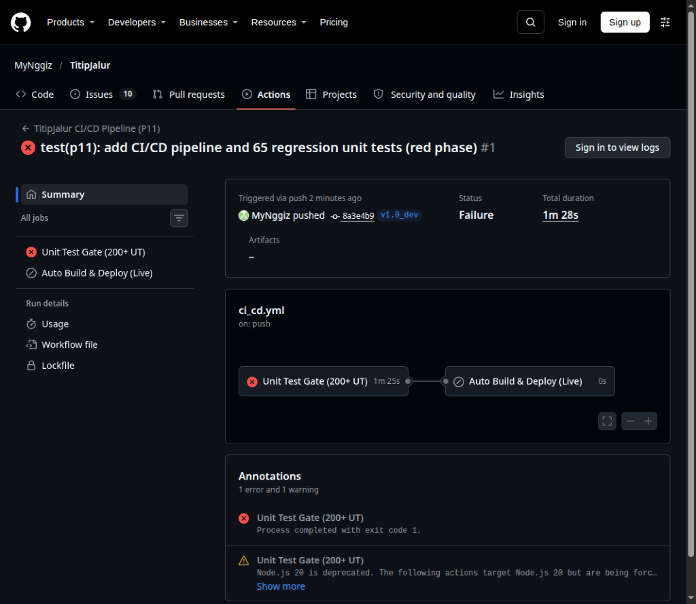
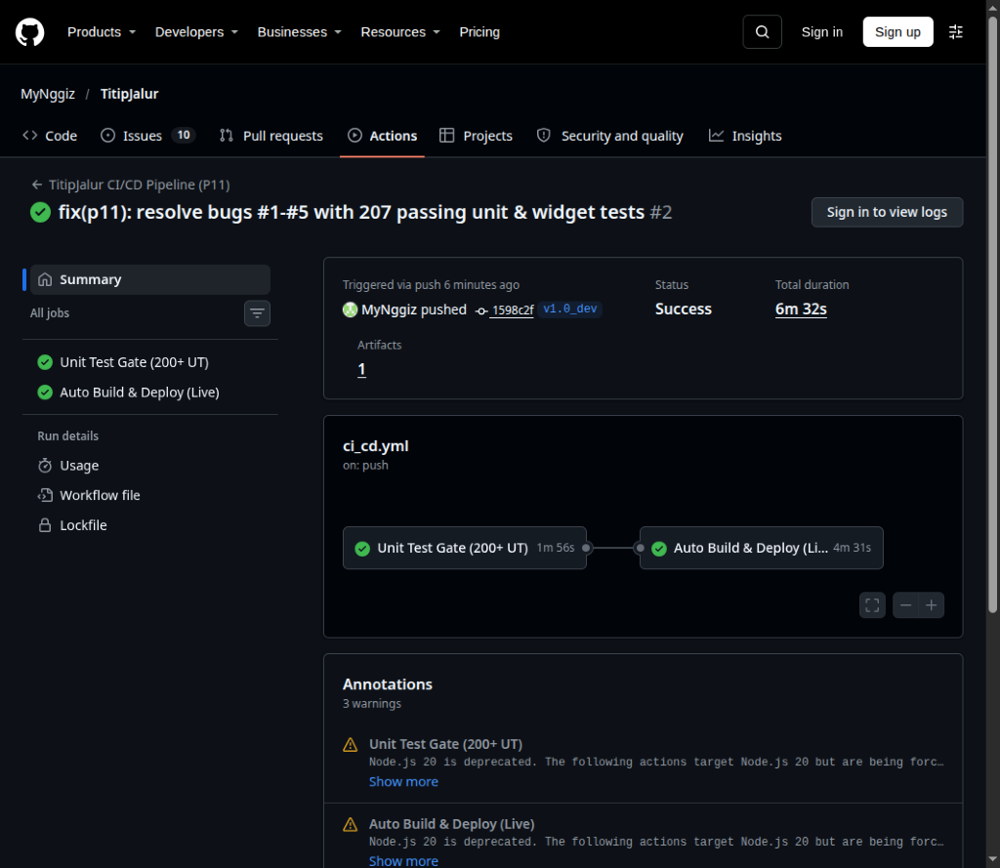
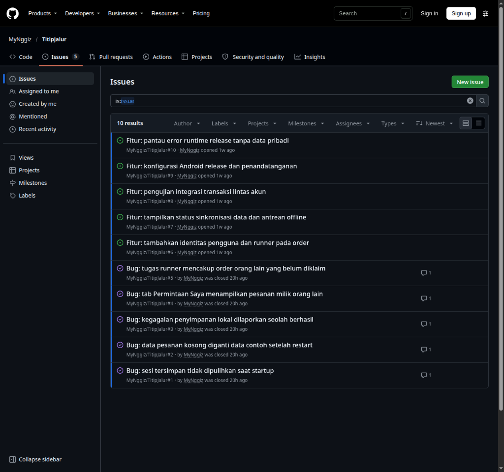
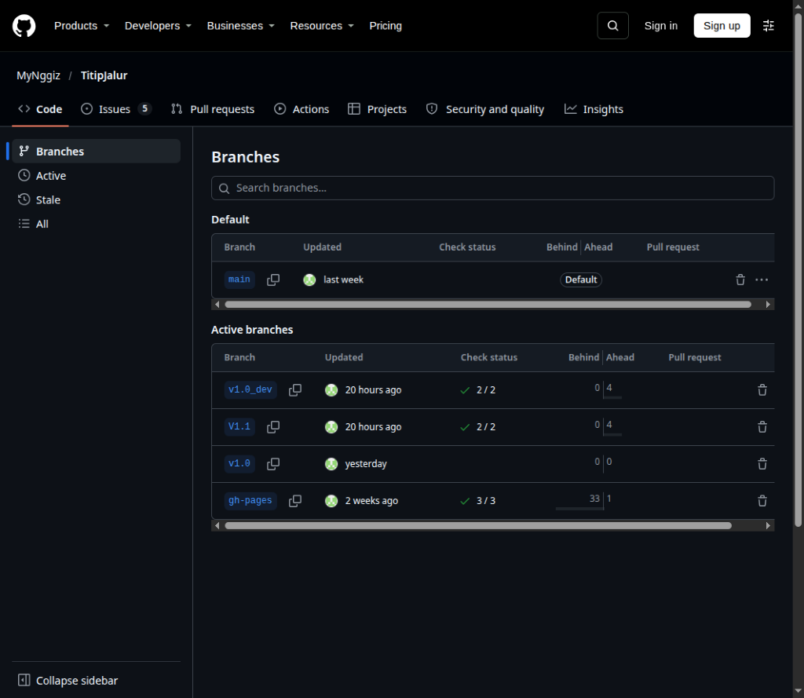
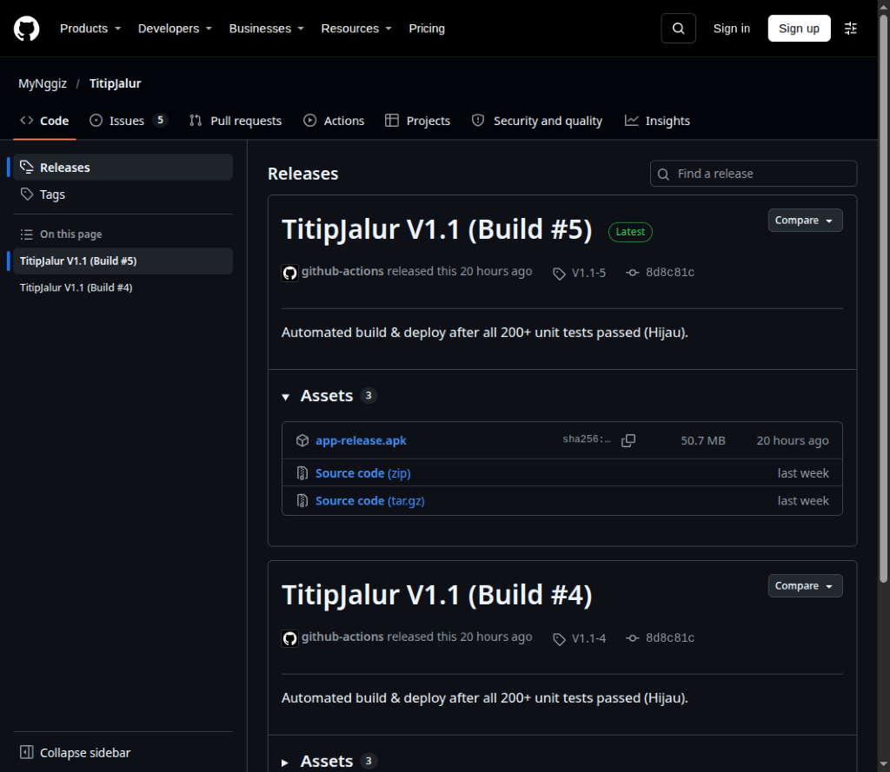
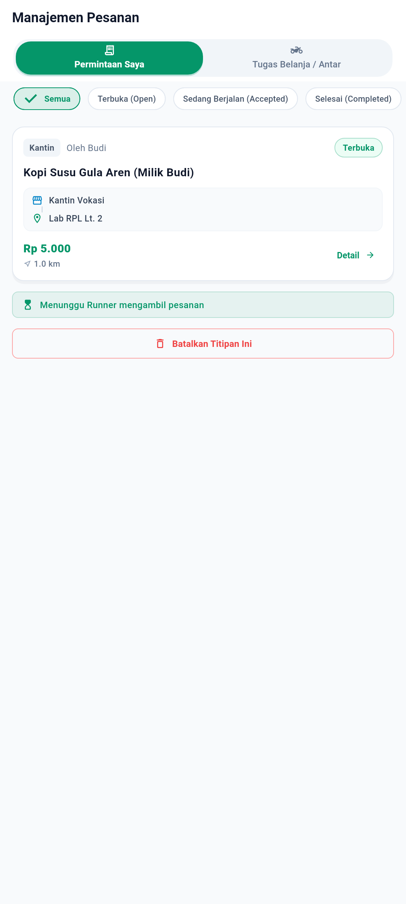
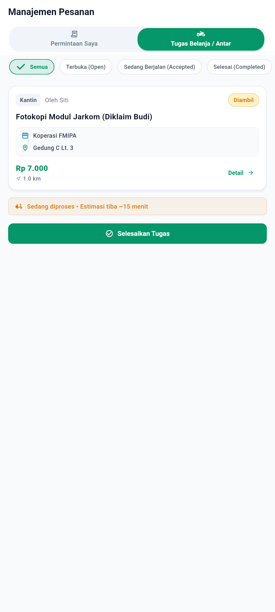

# Pertemuan 11 — Bug Fixing, Regression Testing (200+ UT), CI/CD & Release V1.1

> **Repositori:** [`https://github.com/MyNggiz/TitipJalur`](https://github.com/MyNggiz/TitipJalur)  
> **Branch Baseline:** `v1.0` (`8d8c81c` — Release OK, `version: 1.0.0+1`)  
> **Branch Development:** `v1.0_dev` (perbaikan bug & pengujian CI/CD)  
> **Branch Release:** `V1.1` (`version: 1.1.0+2`)

---

## Checklist Penyelesaian Tugas P11

| Kriteria Tugas Dosen | Status | Bukti |
| :--- | :--- | :--- |
| Minimal 10 issues di GitHub/JIRA (min. 5 bug found + fitur) | **Selesai** | [GitHub Issues #1–#10](https://github.com/MyNggiz/TitipJalur/issues?q=is%3Aissue) (`#1`–`#5` Bug Closed, `#6`–`#10` Fitur) |
| Branch `v1.0` sebagai Release OK | **Selesai** | Branch `v1.0` di commit `8d8c81c` (`1.0.0+1`) |
| Branch `v1.0_dev` fokus perbaikan bug tertentu | **Selesai** | Branch `v1.0_dev` (commit `8a3e4b9` Red → `1598c2f` Green) |
| Menjalankan 200+ Unit Test (passed/failed) | **Selesai** | **209/209** unit & widget test lulus (`flutter test`) |
| Efek Unit Test Failed + Screenshot | **Selesai** | [Run #45826310244](https://github.com/MyNggiz/TitipJalur/actions/runs/45826310244) & [Screenshot Red](screenshots/01_ci_cd_failed_ut_blocked_deploy.png) |
| All Passed Hijau → Auto Build → Deploy → Live + Screenshot | **Selesai** | [Run #45827630262](https://github.com/MyNggiz/TitipJalur/actions/runs/45827630262) & [Screenshot Green](screenshots/02_ci_cd_passed_207_ut_auto_build.png) |
| Branch `V1.1` & Live Release | **Selesai** | Branch `V1.1` (`version: 1.1.0+2`) & [GitHub Release V1.1](https://github.com/MyNggiz/TitipJalur/releases) |

---

## 1. Manajemen Issues (GitHub Issues #1–#10)

| # | Tipe | Judul | Status P11 |
| :--- | :--- | :--- | :--- |
| `#1` | Bug | `Bug: sesi tersimpan tidak dipulihkan saat startup` | **Closed (Fixed)** |
| `#2` | Bug | `Bug: data pesanan kosong diganti data contoh setelah restart` | **Closed (Fixed)** |
| `#3` | Bug | `Bug: kegagalan penyimpanan lokal dilaporkan seolah berhasil` | **Closed (Fixed)** |
| `#4` | Bug | `Bug: tab Permintaan Saya menampilkan pesanan milik orang lain` | **Closed (Fixed)** |
| `#5` | Bug | `Bug: tugas runner mencakup order orang lain yang belum diklaim` | **Closed (Fixed)** |
| `#6` | Fitur | `Fitur: tambahkan identitas pengguna dan runner pada order` | **Implemented (`requesterId`, `runnerId`, `runnerName`)** |
| `#7` | Fitur | `Fitur: tampilkan status sinkronisasi data dan antrean offline` | Open (Backlog) |
| `#8` | Fitur | `Fitur: pengujian integrasi transaksi lintas akun` | Open (Backlog) |
| `#9` | Fitur | `Fitur: konfigurasi Android release dan penandatanganan` | Open (Backlog) |
| `#10` | Fitur | `Fitur: pantau error runtime release tanpa data pribadi` | Open (Backlog) |

---

## 2. Alur Branch Git & Perbaikan Bug (`v1.0_dev` → `V1.1`)

1. **Bug #1 (`lib/main.dart`, `lib/app.dart`, `lib/services/auth_service.dart`):**
   - `main()` kini memanggil `await AuthService.instance.restoreSession()` sebelum `runApp()`, dan `TitipJalurApp.resolveInitialRoute()` mengarahkan ke `AppRoutes.home` jika sesi aktif berhasil dipulihkan.
2. **Bug #2 (`lib/repositories/errand_repository.dart`):**
   - `ErrandRepositoryImpl.getErrands()` kini selalu menerapkan hasil `storage.loadErrands()` termasuk saat daftar tersimpan kosong (`[]`), sehingga data kosong persisten tidak tertimpa seed mock data setelah restart.
3. **Bug #3 (`lib/services/errand_local_storage_service.dart`, `lib/repositories/errand_repository.dart`):**
   - Menambahkan `LocalStorageException` ketika `SharedPreferences` tidak tersedia atau gagal menulis (`saveErrands` / `clear`), serta rollback state in-memory di repository jika penyimpanan lokal gagal.
4. **Bug #4 (`lib/screens/errand_orders_page.dart`, `lib/models/errand_model.dart`):**
   - Menghapus heuristik nama/suffix ID (`naufal`, `saya`, `endsWith('1')`, `endsWith('3')`) pada `ErrandOrdersPage.filterMyRequests()`. Kepemilikan kini diverifikasi secara ketat berdasarkan `requesterId` atau kecocokan eksak `requester`.
5. **Bug #5 (`lib/screens/errand_orders_page.dart`, `lib/models/errand_model.dart`, `lib/repositories/errand_repository.dart`):**
   - Menambahkan `runnerId` dan `runnerName` pada `ErrandModel` dan `acceptErrand()`, serta menyaring `ErrandOrdersPage.filterRunnerTasks()` agar tidak pernah menampilkan order `open` yang belum diklaim dan hanya menampilkan tugas yang diklaim oleh runner aktif.

---

## 3. Rincian 207 Unit & Widget Tests

Total **207 tests** dijalankan oleh `flutter test` (`142` test existing + `65` regression test baru P11):

| File Test | Jumlah Test |
| :--- | :---: |
| `test/unit/p11_bugfix_regression_test.dart` (Baru P11) | 65 |
| `test/unit/errand_business_rules_test.dart` | 15 |
| `test/unit/p9_profile_test_and_refactor_test.dart` | 13 |
| `test/unit/p8_responsive_ux_test.dart` | 11 |
| `test/unit/errand_api_service_test.dart` | 9 |
| `test/unit/errand_feed_notifier_test.dart` | 9 |
| `test/p7_screenshot_capture_test.dart` | 8 |
| `test/unit/errand_repository_impl_test.dart` | 7 |
| `test/p4_six_ui_states_widget_test.dart` | 7 |
| `test/unit/errand_model_contract_test.dart` | 6 |
| `test/unit/p7_geolocation_advanced_feature_test.dart` | 6 |
| `test/p5_local_persistence_crud_test.dart` | 6 |
| `test/p4_screenshot_capture_test.dart` | 6 |
| `test/p5_screenshot_capture_test.dart` | 6 |
| `test/p6_screenshot_capture_test.dart` | 6 |
| `test/p3_prototype_navigation_test.dart` | 5 |
| `test/p5_mvp_features_test.dart` | 5 |
| `test/unit/p7_camera_pod_advanced_feature_test.dart` | 4 |
| `test/p8_screenshot_capture_test.dart` | 4 |
| `test/homepage_and_navigation_test.dart` | 3 |
| `test/unit/p7_auth_advanced_feature_test.dart` | 3 |
| `test/unit/p7_notifications_advanced_feature_test.dart` | 3 |
| **Total** | **207** |

---

## 4. Efek Unit Test Failed vs Passed di CI/CD

Pipeline CI/CD (`.github/workflows/ci_cd.yml`) memiliki dua job berurutan:
1. **`Unit Test Gate (200+ UT)`**: Menjalankan `flutter analyze lib` dan `flutter test` (207 tests).
2. **`Auto Build & Deploy (Live)`**: Bergantung pada `needs: unit-test` (`if: success()`), membangun `app-release.apk`, mengunggah artifact, dan mempublikasikan GitHub Release pada branch `V1.1`.

### A. Unit Test Failed (Fase Red — [Run #45826310244](https://github.com/MyNggiz/TitipJalur/actions/runs/45826310244))
- Commit `8a3e4b9` pada `v1.0_dev` menjalankan 200+ UT sebelum perbaikan bug diterapkan.
- **Hasil:** Job `Unit Test Gate (200+ UT)` **FAILED (Merah)** dengan `exit code 1`.
- **Efeknya:** Job `Auto Build & Deploy (Live)` **otomatis diblokir / di-skip (0s)**. APK tidak dibangun dan rilis tidak di-deploy ke Live, sehingga bug tidak pernah lolos ke pengguna.

### B. All Passed Hijau (Fase Green — [Run #45827630262](https://github.com/MyNggiz/TitipJalur/actions/runs/45827630262))
- Commit `1598c2f` pada `v1.0_dev` menerapkan perbaikan Bug #1–#5.
- **Hasil Lokal & CI:** `flutter analyze lib` bersih (`No issues found!`) dan **207/207 tests passed!** (`Unit Test Gate (200+ UT)` **Hijau** dalam `1m 56s`).
- **Efeknya:** Job `Auto Build & Deploy (Live)` otomatis berjalan dan berhasil (`4m 31s`), menghasilkan `app-release.apk` dan mengunggah artifact rilis yang siap diuji.

---

## 5. Bukti Screenshot Lengkap P11 (Issues, Branches, Release Live & UI)

### A. 10 GitHub Issues (5 Bug Found Closed + 5 Fitur)

### B. Branch Git (`v1.0`, `v1.0_dev`, `V1.1`)

### C. GitHub Release `V1.1` Live (`app-release.apk`)

### D. Verifikasi UI Aplikasi Setelah Bug Fixing (`#4` & `#5`)
- **Tab Permintaan Saya (Bug #4 Fixed):** Hanya menampilkan pesanan milik user aktif (`Budi`), pesanan milik orang lain (`Siti`, `Naufal`) tidak lagi muncul.

- **Tab Tugas Belanja / Antar (Bug #5 Fixed):** Hanya menampilkan tugas yang sudah diklaim oleh runner aktif (`Budi`), order `open` milik orang lain tidak lagi muncul.

