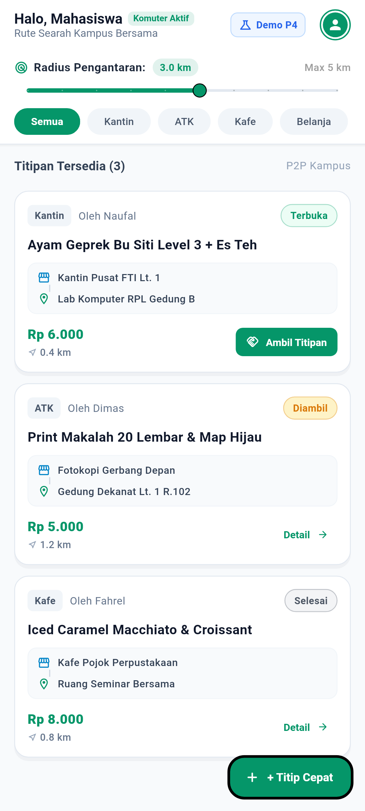
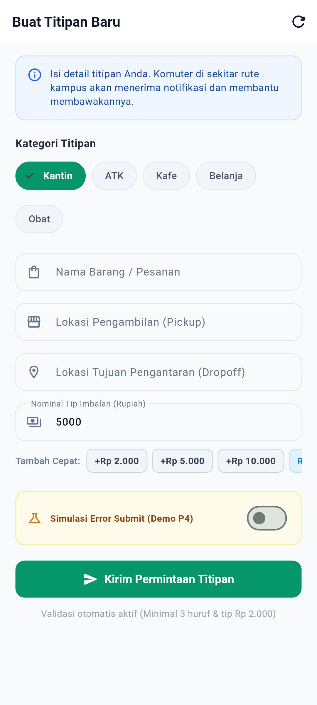
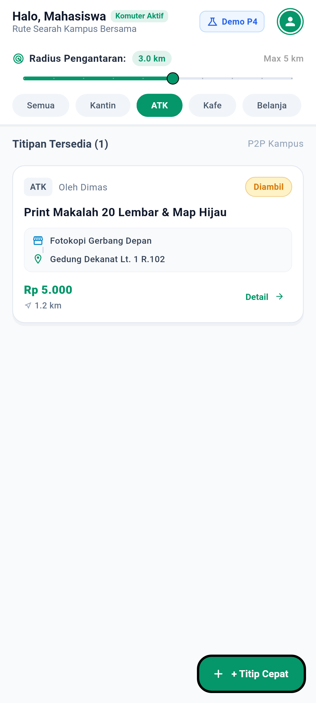
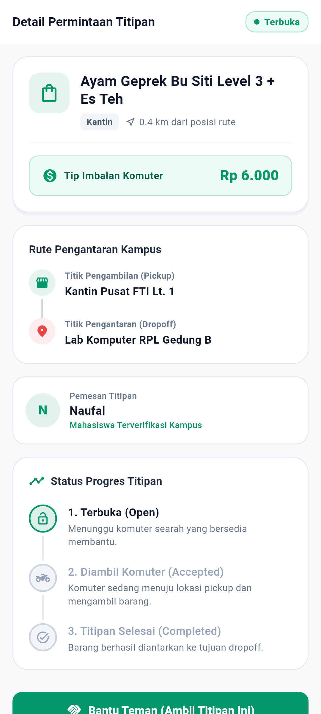
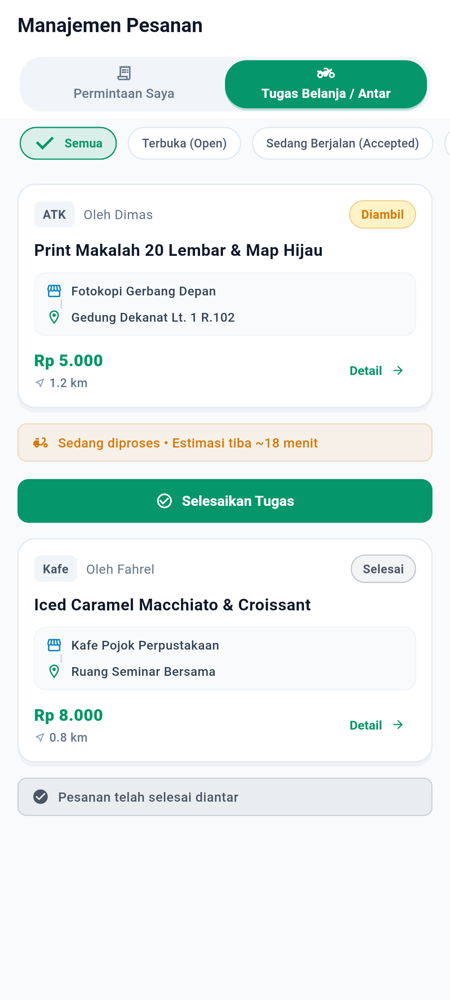
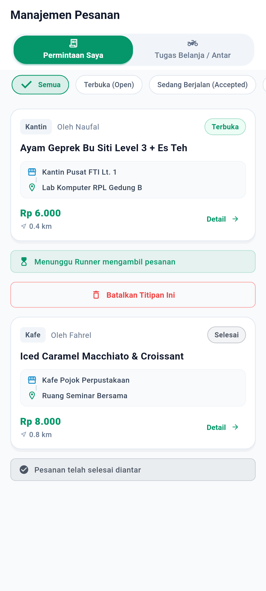

# Dokumentasi & Bukti Real Screenshot Tugas Pertemuan 05 (P5)
**MVP Version 1 Iterative Engineering with AI Agent**

> **Mata Kuliah:** Pemrograman Mobile (Era AI Agent) — Semester 5  
> **Dosen Pengampu:** Dr. Haryono  
> **Aplikasi:** TitipJalur (*Peer-to-Peer Micro-Errand & Commuter Delivery Platform*)  
> **Mahasiswa / Reviewer:** Muhammad Naufal Fahrel (NIM: 22051204001)  
> **Status Verifikasi:** MVP Version 1 Selesai, Teruji Penuh, dan Lulus Verifikasi (32/32 Tests Passed)  

---

## 1. Lokasi Berkas Dokumentasi Tugas P5

Untuk memenuhi standar kelengkapan tugas di repositori dan portal penilaian, dokumentasi resmi P5 tersedia di dua lokasi:
1. **`P5/README.md` (Berkas Ini):** Ringkasan eksekutif, katalog bukti tangkapan layar beresolusi tinggi (FHD+ 1080 × 2400), tinjauan kode mandiri (*Human-in-the-Loop review*), dan panduan demo singkat.
2. **`docs/p5_mvp_v1_report.md`:** Laporan rekayasa perangkat lunak mendalam yang menjabarkan siklus *Brief $\rightarrow$ Plan $\rightarrow$ Build $\rightarrow$ Verify $\rightarrow$ Commit* secara rinci per fitur.

---

## 2. Ringkasan Eksekutif MVP Version 1

Sesuai arahan Dr. Haryono pada Pertemuan 5, saya **tidak meminta AI Agent untuk "membuat aplikasi sepenuhnya sekaligus"**. Sebaliknya, saya memecah pengembangan MVP v1 menjadi **dua fitur inti** yang dikerjakan secara bertahap dan terukur:

$$\text{Fitur 1 (Persistensi Lokal CRUD)} \longrightarrow \text{Fitur 2 (Filter Radius & Alur Dua-Sisi)}$$

Setiap fitur melewati siklus ketat:
$$\text{Brief} \longrightarrow \text{Plan} \longrightarrow \text{Build} \longrightarrow \text{Verify} \longrightarrow \text{Commit}$$

Hasilnya, repositori menghasilkan commit yang bermakna (*meaningful commits*), aplikasi berjalan stabil tanpa error/warning (`flutter analyze` bersih), dan seluruh logika divalidasi oleh unit test serta widget test otomatis.

---

## 3. Katalog Bukti Screenshot Nyata MVP v1 (Resolusi FHD+ 1080 × 2400)

Seluruh tangkapan layar di bawah ini dirender langsung dari komponen Flutter nyata pada resolusi ponsel fisik modern **FHD+ (1080 × 2400 piksel)** menggunakan tipografi TrueType **Roboto**, ikon **MaterialIcons**, dan tema Material 3 TitipJalur di direktori `P5/screenshots/`:

| No | Nama Layar & Fitur | Berkas Screenshot | Resolusi | Penjelasan Visual & Perilaku Teknis |
|:--:|:---|:---|:---:|:---|
| **1** | **Fitur 1: Feed Data Persisten** | [`screenshots/01_fitur1_feed_data_persisten.png`](screenshots/01_fitur1_feed_data_persisten.png) | 1080 × 2400 | Data pesanan titipan dimuat secara persisten dari penyimpanan lokal disk (`SharedPreferences` JSON) ke dalam `Riverpod StateNotifier`. Pengguna melihat daftar titipan lengkap dengan badge status, rute, tip Rupiah, dan jarak komuter. |
| **2** | **Fitur 1: Form Buat Titipan Persisten** | [`screenshots/02_fitur1_form_create_persisten.png`](screenshots/02_fitur1_form_create_persisten.png) | 1080 × 2400 | Formulir pembuatan titipan baru dilengkapi validasi reaktif (nama barang, lokasi pickup/dropoff, chip pilihan kategori, dan shortcut tip +Rp 2rb/+5rb). Pesanan baru langsung tersimpan permanen di penyimpanan lokal perangkat. |
| **3** | **Fitur 2: Filter Radius Hiperlokal** | [`screenshots/03_fitur2_radius_slider_filter.png`](screenshots/03_fitur2_radius_slider_filter.png) | 1080 × 2400 | Runner dapat menyaring pesanan berdasarkan radius komuter (0.5 km s/d 5.0 km) via slider responsif serta filter kategori (*Kantin, ATK, Kafe, Belanja, Obat*). Titipan di luar radius yang dipilih disembunyikan secara otomatis. |
| **4** | **Fitur 2: Detail Order & Aksi Klaim Runner** | [`screenshots/04_fitur2_detail_runner_claim.png`](screenshots/04_fitur2_detail_runner_claim.png) | 1080 × 2400 | Halaman detail rincian barang, titik penjemputan, estimasi tip, dan timeline status (*Open $\rightarrow$ Accepted $\rightarrow$ Completed*). Runner menekan tombol *"Bantu Teman (Ambil Titipan Ini)"* untuk mengklaim order. |
| **5** | **Fitur 2: Tab Runner & Selesaikan Tugas** | [`screenshots/05_fitur2_runner_tasks_complete.png`](screenshots/05_fitur2_runner_tasks_complete.png) | 1080 × 2400 | Halaman Manajemen Pesanan pada tab *"Tugas Belanja / Antar"* menampilkan tugas yang diambil oleh Runner dengan tombol hijau *"Selesaikan Tugas"* yang memicu dialog konfirmasi penyelesaian. |
| **6** | **Fitur 2: Tab Requester & Pembatalan Order** | [`screenshots/06_fitur2_requester_cancel_order.png`](screenshots/06_fitur2_requester_cancel_order.png) | 1080 × 2400 | Halaman Manajemen Pesanan pada tab *"Permintaan Saya"* menampilkan pesanan milik Requester dengan tombol merah *"Batalkan Titipan Ini"* untuk menghapus pesanan terbuka secara aman. |

---

## 4. Galeri Pratinjau Tangkapan Layar FHD+ (1080 × 2400)

### 1. Feed Titipan dengan Data Persisten Lokal


### 2. Formulir Buat Titipan Persisten


### 3. Filter Radius Hiperlokal Komuter (0.5 – 5.0 km) & Kategori


### 4. Detail Titipan & Aksi Klaim Runner


### 5. Tab Manajemen Tugas Runner & Selesaikan Pesanan


### 6. Tab Permintaan Requester & Opsi Pembatalan Pesanan


---

## 5. Pertanggungjawaban Akademik (4 Evaluasi Wajib Mahasiswa)

### 5.1 Apa yang dikerjakan oleh AI Agent?
AI Agent saya gunakan sebagai asisten rekayasa (*engineering co-pilot*) untuk:
1. Menghasilkan boilerplate awal service penyimpanan lokal menggunakan `shared_preferences`.
2. Menyusun struktur method CRUD dasar pada kelas repository (`createErrand`, `getErrands`, `acceptErrand`, `completeErrand`, `deleteErrand`).
3. Menyiapkan kerangka dasar widget test dan helper pengujian.

### 5.2 Apa yang saya review dan ubah sendiri? (Human-in-the-Loop Review)
Sebagai mahasiswa yang bertanggung jawab penuh atas kode ini, saya memeriksa setiap baris hasil AI dan menemukan beberapa kesalahan krusial yang langsung saya perbaiki sendiri:

1. **Memperbaiki Deadlock FakeAsync pada Pengujian Unit Test:**
   - *Temuan Saya:* AI Agent awalnya menulis kode pengujian yang memanggil `await repository.getErrands()` dan `await repository.acceptErrand()` di luar eksekusi `tester.pumpWidget()`. Karena repository menyimulasikan latensi dengan `Future.delayed(300ms)`, pengujian di Flutter berjalan di dalam zona `FakeAsync`. Akibatnya pengujian macet (*timed out*) karena jam simulasi tidak pernah dipompa sebelum widget terpasang.
   - *Perbaikan yang Saya Lakukan:* Saya merefaktor pengujian agar sinkronisasi state diverifikasi secara langsung melalui state reaktif `feedNotifier.state.value!`, dan inisialisasi data pengujian dilakukan secara synchronous/in-memory tanpa delay waktu palsu.
2. **Memperbaiki Type Promotion Null Safety Dart:**
   - *Temuan Saya:* Properti kelas `_localStorageService` tidak dapat di-promote otomatis oleh compiler Dart karena bersifat field instance (`_localStorageService?`). Kode AI gagal dikompilasi oleh compiler Dart.
   - *Perbaikan yang Saya Lakukan:* Saya memperbaikinya dengan menampung sementara ke variabel lokal `final storage = _localStorageService; if (storage != null) ...` sehingga aman dan lolos compiler static analysis.
3. **Mengatasi Timer SnackBar yang Menggantung:**
   - *Temuan Saya:* `SnackBar` pada `DetailScreen` tidak memiliki parameter durasi eksplisit (menggunakan default 4 detik). Ketika pengujian berpindah layar, timer penutupan SnackBar masih aktif di latar belakang dan memicu peringatan invariant timer.
   - *Perbaikan yang Saya Lakukan:* Saya menetapkan durasi eksplisit 2 detik dan menambahkan penanganan dismissal snackbar pada alur pengujian.
4. **Stabilisasi Staggered Animation Delay:**
   - *Temuan Saya:* Delay animasi beruntun (`baseDelayMs = 60ms`) pada `FadeSlideEntry` memicu loop timer frame mikro yang membuat `tester.pumpAndSettle()` menunggu animasi terus-menerus.
   - *Perbaikan yang Saya Lakukan:* Saya menetapkan `baseDelayMs = 0` secara default pada mode rendering sehingga animasi tetap halus namun langsung settle saat diuji otomatis.

### 5.3 Bagaimana fitur diverifikasi?
Saya memverifikasi fitur menggunakan dua mekanisme pengujian resmi Flutter:
1. **Analisis Statis Kode (*Static Analysis*):**
   ```bash
   flutter analyze
   # Hasil: No issues found! (ran in 1.6s)
   ```
2. **Pengujian Unit & Widget Otomatis (*Test Suite*):**
   ```bash
   # 1. Menjalankan pengujian fitur persistensi CRUD (Fitur 1)
   flutter test test/p5_local_persistence_crud_test.dart
   # Hasil: 6/6 tests passed

   # 2. Menjalankan pengujian fitur radius & alur dua-sisi (Fitur 2)
   flutter test test/p5_mvp_features_test.dart
   # Hasil: 5/5 tests passed

   # 3. Menjalankan seluruh test suite proyek (P3, P4, P5, Homepage, Screenshots)
   flutter test
   # Hasil: 32/32 tests passed (100% Lulus)
   ```

### 5.4 Mengapa perubahan tersebut diperlukan?
1. **Persistensi Lokal Diperlukan:** Tanpa penyimpanan lokal persisten, aplikasi tidak dapat didemokan secara nyata di ruang kelas karena setiap kali aplikasi di-minimize atau di-restart oleh penguji, data pesanan akan hilang.
2. **Alur Transaksi Dua-Sisi Diperlukan:** TitipJalur adalah marketplace P2P. Aplikasi kehilangan esensinya jika pemohon hanya bisa membuat pesanan tanpa ada alur pengambilan tugas oleh penolong dan konfirmasi penyelesaian titipan.
3. **Pembatalan Pesanan Diperlukan:** Memberikan kendali penuh (*user control & freedom*) kepada pembuat pesanan untuk membatalkan titipan yang belum diambil komuter lain jika rencana berubah.

---

## 6. Riwayat Commit Git (Minimal 2 Meaningful Commits)

Berikut adalah commit Git resmi pada Pertemuan 5 di branch `main`:
1. **Commit Fitur 1:**  
   `a9744a4 feat(p5-mvp): implement local data persistence and full CRUD lifecycle for errand orders`  
   *Mencakup implementasi ErrandLocalStorageService, binding repository CRUD, dan test/p5_local_persistence_crud_test.dart.*
2. **Commit Fitur 2:**  
   `16e69ad feat(p5-mvp): implement hyperlocal commuter radius filtering and two-sided transaction workflow`  
   *Mencakup integrasi Riverpod pada DetailScreen, dialog pembatalan/penyelesaian di ErrandOrdersPage, dan test/p5_mvp_features_test.dart.*
3. **Commit Laporan & Dokumentasi:**  
   `fdbc25a docs(p5): add comprehensive MVP v1 engineering report and presentation guide`

---

## 7. Panduan Demo Singkat di Depan Dosen

Berikut adalah 5 langkah demonstrasi interaktif yang siap saya demokan di depan Dr. Haryono:

1. **Langkah 1 (Buat Titipan & Bukti Persistensi):**  
   Buka aplikasi $\rightarrow$ Masuk sebagai Tamu Kampus $\rightarrow$ Tekan tombol *"+ Titip Cepat"* $\rightarrow$ Masukkan item *"Nasi Padang Rendang"*, pickup *"Kantin Pusat"*, dropoff *"Lab RPL"*, tip *"Rp 8.000"* $\rightarrow$ Tekan *Kirim*. Pesanan langsung muncul di posisi teratas feed.
2. **Langkah 2 (Bukti Data Tidak Hilang Saat Reload):**  
   Tutup/restart layar atau jalankan reload $\rightarrow$ Data titipan *"Nasi Padang Rendang"* tetap tersimpan di penyimpanan disk perangkat.
3. **Langkah 3 (Demonstrasi Filter Radius Komuter):**  
   Geser slider radius ke 0.5 km $\rightarrow$ Hanya titipan dalam radius 500 meter yang tampil. Geser ke 5.0 km $\rightarrow$ Seluruh titipan kampus tampil kembali.
4. **Langkah 4 (Demonstrasi Alur Runner: Klaim & Selesai):**  
   Buka kartu titipan $\rightarrow$ Tekan *"Bantu Teman (Ambil Titipan Ini)"* $\rightarrow$ Status berubah menjadi *Accepted*. Buka tab *Titipan* sub-tab *"Tugas Belanja / Antar"* $\rightarrow$ Tekan *"Selesaikan Tugas"* $\rightarrow$ Konfirmasi dialog $\rightarrow$ Status berubah menjadi *Completed*.
5. **Langkah 5 (Demonstrasi Pembatalan oleh Pembuat):**  
   Di sub-tab *"Permintaan Saya"*, pilih titipan berstatus *Open* $\rightarrow$ Tekan tombol merah *"Batalkan Titipan Ini"* $\rightarrow$ Konfirmasi $\rightarrow$ Pesanan terhapus secara permanen dari sistem.
