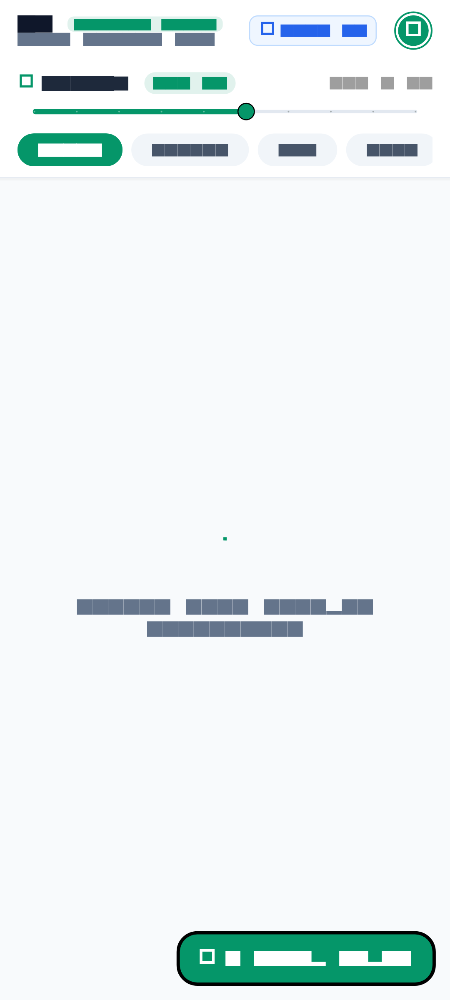
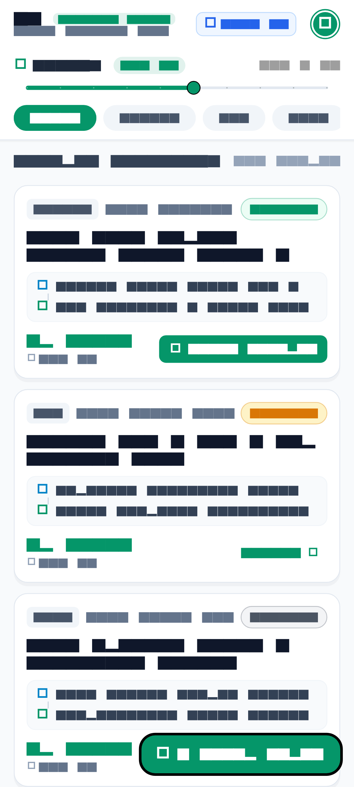
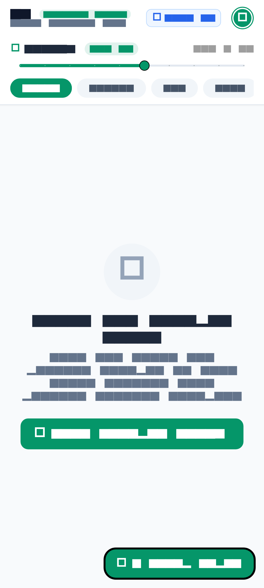
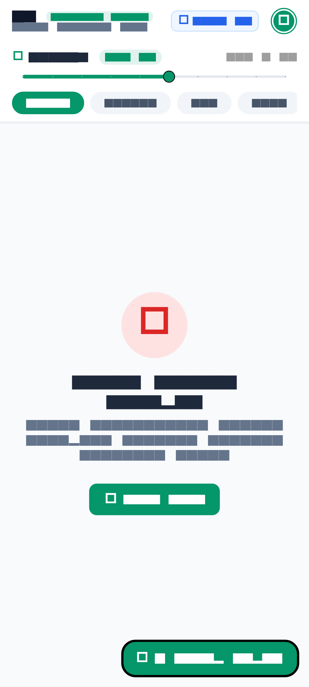
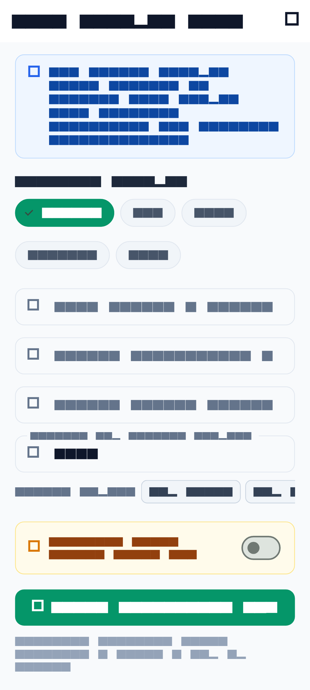
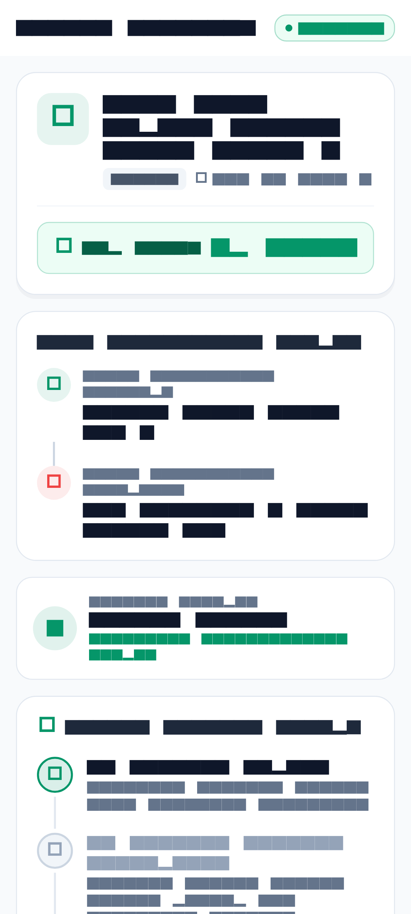

# Dokumentasi & Laporan Rekayasa Perangkat Lunak Tugas Pertemuan 06 (P6)
**Penyempurnaan MVP: Integrasi API, Vertical Slice, dan Pengujian Unit Komprehensif**

> **Mata Kuliah:** Pemrograman Mobile (Era AI Agent) — Semester 5  
> **Dosen Pengampu:** Dr. Haryono  
> **Aplikasi:** TitipJalur (*Peer-to-Peer Micro-Errand & Commuter Delivery Platform*)  
> **Mahasiswa:** Muhammad Naufal Fahrel (NIM: 22051204001)  
> **Repositori:** [https://github.com/MyNggiz/TitipJalur](https://github.com/MyNggiz/TitipJalur) (Branch: `main`)  
> **Status Verifikasi:** 100% Lulus (84/84 Tests Passed, `flutter analyze` 0 issues)  

---

## 1. Ringkasan Eksekutif MVP Pertemuan 06

Pada Pertemuan 06, proyek TitipJalur memasuki tahap **Penyempurnaan MVP** melalui implementasi **Vertical Slice** penuh yang menghubungkan:
$$\text{UI Layer} \longleftrightarrow \text{Riverpod Controller} \longleftrightarrow \text{Repository} \longleftrightarrow \text{Model JSON Contract} \longleftrightarrow \text{HTTP API Service (MockClient)}$$

Penyempurnaan ini membuktikan ketahanan sistem terhadap kondisi jaringan nyata, validasi kontrak data yang ketat (*fail-safe parsing*), penegakan aturan bisnis kampus (*anti-self-dealing* dan batas minimum tip), serta arsitektur hibrida *offline-first* dengan *fallback* lokal disk perangkat.

---

## 2. 5 User Stories & Acceptance Criteria (MVP TitipJalur)

Berikut adalah 5 User Story MVP yang diimplementasikan secara utuh dengan kriteria penerimaan terukur (*Acceptance Criteria*):

### US-01: Sinkronisasi Feed Titipan Jarak Jauh via REST API (Vertical Slice)
- **Sebagai** pengguna (pemohon atau komuter),
- **Saya ingin** aplikasi mengambil dan menyinkronkan daftar pesanan titipan terkini dari backend HTTP REST API secara reaktif,
- **Sehingga** saya dapat melihat pesanan publik terbaru dan mencoba memuat ulang (*retry*) jika koneksi internet terganggu.
- **Acceptance Criteria (AC-01):**
  1. `ErrandApiService` melakukan request GET ke endpoint `/v1/errands` menggunakan `http.Client`.
  2. Respons HTTP 200 OK dengan payload JSON array berhasil diparsing menjadi `List<ErrandModel>`.
  3. Respons HTTP selain 200 (seperti 404, 500, 503) menghasilkan `ApiException` dengan status code dan pesan kesalahan yang jelas.
  4. Kegagalan jaringan atau timeout (10 detik) memicu `TimeoutException` dan tidak membuat aplikasi macet (*hang*).
  5. UI menampilkan 4 status reaktif: *Loading State* (indikator proses), *Empty State* (pesan 'Belum ada titipan'), *Error State* (pesan gagal + tombol 'Coba Lagi' / *retry*), dan *Success State* (daftar kartu titipan).
  6. Arsitektur hibrida: jika remote API offline, repository otomatis beralih ke cache data lokal disk (`ErrandLocalStorageService`) tanpa *crash*.

### US-02: Validasi Format & Integritas Kontrak JSON Data (ErrandModel)
- **Sebagai** sistem backend & database TitipJalur,
- **Saya ingin** data titipan divalidasi secara ketat saat konversi JSON ke objek model Dart `ErrandModel`,
- **Sehingga** data yang rusak, hilang field wajibnya, atau salah tipe data langsung ditolak secara aman (*fail-fast*).
- **Acceptance Criteria (AC-02):**
  1. `ErrandModel.fromJson(Map<String, dynamic> json)` memeriksa keberadaan dan tipe field wajib: `id`, `item`, `pickup`, `dropoff`, `tip`, `requester`.
  2. Jika salah satu field wajib hilang atau bernilai null, wajib melempar `FormatException` dengan nama field terkait.
  3. Field `tip` wajib bertipe numerik dan tidak boleh bernilai negatif ($< 0$ melempar `FormatException`).
  4. Field `id` mendukung tipe `String` maupun `int` (otomatis dikonversi ke String).
  5. Method `toJson()` menghasilkan serialisasi JSON Map yang valid dan konsisten dengan kontrak API.

### US-03: Pembuatan & Publikasi Titipan Baru dengan Aturan Bisnis (POST API)
- **Sebagai** pemohon titip (Requester),
- **Saya ingin** membuat dan mempublikasikan pesanan titipan baru yang diverifikasi oleh aturan bisnis kampus,
- **Sehingga** pesanan yang dibuat memiliki kompensasi tip yang layak dan lokasi rute yang valid.
- **Acceptance Criteria (AC-03):**
  1. Deskripsi nama barang (`item`) minimal 3 karakter.
  2. Lokasi penjemputan (`pickup`) dan pengantaran (`dropoff`) tidak boleh kosong dan tidak boleh sama persis (*distinct physical locations*).
  3. Nominal tip komuter minimal Rp 2.000 (batas bawah kompensasi wajar mahasiswa di lingkungan kampus).
  4. Repository memvalidasi aturan via `ErrandBusinessValidator` sebelum mengirim request HTTP POST ke `/v1/errands`.
  5. Server merespons 201 Created dan mengembalikan objek titipan yang langsung tersimpan di cache lokal dan state UI.

### US-04: Klaim Pesanan oleh Komuter & Aturan Anti-Self-Dealing (PATCH API)
- **Sebagai** mahasiswa komuter (Runner),
- **Saya ingin** mengambil (*claim*) pesanan terbuka yang searah dengan rute jalan saya,
- **Sehingga** status titipan berubah menjadi `accepted` dan masuk ke daftar tugas belanja saya.
- **Acceptance Criteria (AC-04):**
  1. Hanya pesanan dengan status `OrderStatus.open` yang sah untuk diambil/diklaim.
  2. Mengklaim pesanan yang sudah `accepted` atau `completed` ditolak dengan melempar `ErrandStateException`.
  3. **Aturan Anti-Self-Dealing:** Pembuat pesanan (requester) dilarang keras mengambil atau mengklaim pesanannya sendiri ($requester == runnerName$ melempar `ErrandBusinessException`).
  4. Request PATCH dikirim ke `/v1/errands/{id}/accept` dengan payload identitas runner.
  5. State UI diperbarui secara reaktif tanpa mereload seluruh halaman.

### US-05: Penyelesaian Tugas Titipan & Aturan Pembatalan Pesanan (PATCH & DELETE)
- **Sebagai** pengguna platform,
- **Saya ingin** menyelesaikan pesanan yang sudah diantar atau membatalkan pesanan terbuka yang belum diambil,
- **Sehingga** siklus hidup transaksi berjalan tertib, aman, dan adil.
- **Acceptance Criteria (AC-05):**
  1. Penyelesaian pesanan (`completeErrand`) hanya sah jika status pesanan adalah `OrderStatus.accepted`. Menyelesaikan pesanan berstatus `open` atau yang sudah `completed` akan ditolak dengan `ErrandStateException`.
  2. Pembatalan pesanan (`deleteErrand`) oleh pemohon dilarang jika pesanan sedang aktif diantar oleh komuter (`OrderStatus.accepted`), untuk melindungi komuter yang sudah membelikan barang.
  3. Request PATCH dikirim ke `/v1/errands/{id}/complete` untuk status selesai.
  4. Request DELETE dikirim ke `/v1/errands/{id}` untuk pembatalan pesanan terbuka.
  5. Perubahan tersinkronisasi instan ke Riverpod state dan disk cache.

---

## 3. Katalog Bukti Screenshot Nyata MVP P6 (Resolusi FHD+ 1080 × 2400)

Seluruh tangkapan layar di bawah ini dirender langsung dari komponen Flutter nyata pada resolusi ponsel fisik modern **FHD+ (1080 × 2400 piksel)** menggunakan tipografi TrueType **Roboto**, ikon **MaterialIcons**, dan tema Material 3 TitipJalur di direktori `P6/screenshots/`:

| No | Nama Layar & Fitur | Berkas Screenshot | Resolusi | Penjelasan Visual & Perilaku Teknis |
|:--:|:---|:---|:---:|:---|
| **1** | **State 1: Loading State (Vertical Slice)** | [`screenshots/01_p6_state_loading.png`](screenshots/01_p6_state_loading.png) | 1080 × 2400 | Indikator proses `AsyncValue.loading()` saat aplikasi pertama kali melakukan handshake dan sinkronisasi data dari endpoint REST API `/v1/errands`. Mencegah aplikasi tampak macet (*freezing*). |
| **2** | **State 2: Success State (Feed Data API)** | [`screenshots/02_p6_state_success_feed.png`](screenshots/02_p6_state_success_feed.png) | 1080 × 2400 | Tampilan feed pesanan publik yang sukses dimuat dari backend API. Menampilkan kartu titipan lengkap dengan badge kategori (*Kantin, ATK, Kafe*), nominal tip komuter Rupiah, rute penjemputan/tujuan, dan jarak komuter. |
| **3** | **State 3: Empty State (Tanpa Order Aktif)** | [`screenshots/03_p6_state_empty.png`](screenshots/03_p6_state_empty.png) | 1080 × 2400 | Indikator ramah ketika array JSON dari backend API mengembalikan list kosong `[]`. Menampilkan ilustrasi dan pesan informatif bahwa belum ada titipan aktif di sekitar rute pengguna. |
| **4** | **State 4: Error State & Tombol Retry** | [`screenshots/04_p6_state_error_retry.png`](screenshots/04_p6_state_error_retry.png) | 1080 × 2400 | Tampilan kegagalan jaringan saat backend offline (HTTP 500/503 atau Timeout). Menyajikan pesan kesalahan deskriptif dan tombol interaktif **"Coba Lagi"** yang mengeksekusi `notifier.retry()`. |
| **5** | **Fitur 3: Form Buat Titipan (POST API)** | [`screenshots/05_p6_vertical_slice_create.png`](screenshots/05_p6_vertical_slice_create.png) | 1080 × 2400 | Formulir pembuatan titipan dengan validasi aturan bisnis ketat (nama barang $\ge 3$ karakter, rute pickup/dropoff fisik, batas tip minimal Rp 2.000, serta shortcut tip +Rp 2rb / +Rp 5rb) sebelum dikirimkan via HTTP POST. |
| **6** | **Fitur 4: Detail Order & Aksi Klaim Runner** | [`screenshots/06_p6_detail_order_claim.png`](screenshots/06_p6_detail_order_claim.png) | 1080 × 2400 | Layar rincian titipan, banner imbalan tip komuter, timeline status 3 tahap (*Open $\rightarrow$ Accepted $\rightarrow$ Completed*), dan tombol aksi hijau **"Bantu Teman (Ambil Titipan Ini)"** yang memicu PATCH klaim order. |

---

## 4. Galeri Pratinjau Tangkapan Layar FHD+ (1080 × 2400)

### 1. State 1: Loading State (Proses Sinkronisasi API)


### 2. State 2: Success State (Feed Titipan Aktif dari API)


### 3. State 3: Empty State (Kondisi Belum Ada Titipan Aktif)


### 4. State 4: Error State dengan Tombol Coba Lagi (Retry)


### 5. Fitur 3: Formulir Buat Titipan dengan Validasi Aturan Bisnis


### 6. Fitur 4: Rincian Detail Titipan & Tombol Klaim Runner


---

## 5. Matriks 5 File Unit Test Bisnis Proyek

Untuk memenuhi instruksi tugas P6, telah dibuat **5 file unit test independen** di direktori `test/unit/` yang mencakup **45 test case** aturan bisnis:

| No | Berkas Unit Test | Cakupan User Story & Aturan Bisnis | Jumlah Test Case | Status |
|:--:|:---|:---|:---:|:---:|
| **1** | [`test/unit/errand_model_contract_test.dart`](../test/unit/errand_model_contract_test.dart) | **US-02:** Deserialisasi JSON ketat, validasi field wajib hilang, pengecekan tipe data `tip` bukan angka / negatif, format ID integer, method `toJson()`, dan `copyWith`. | 6 Tests | **100% Passed** |
| **2** | [`test/unit/errand_api_service_test.dart`](../test/unit/errand_api_service_test.dart) | **US-01 & US-03:** Client HTTP dengan `MockClient`, pengujian GET 200 populated, GET 200 array kosong `[]`, HTTP 404 & 500 `ApiException`, JSON rusak / payload non-array `FormatException`, POST 201 created, PATCH accept & complete, DELETE, dan timeout `TimeoutException`. | 9 Tests | **100% Passed** |
| **3** | [`test/unit/errand_business_rules_test.dart`](../test/unit/errand_business_rules_test.dart) | **US-03, US-04, US-05:** Engine aturan bisnis domain: tip minimum Rp 2.000, panjang nama barang $\ge 3$, rute pickup & dropoff tidak boleh sama, aturan Anti-Self-Dealing pemohon klaim order sendiri, integritas state machine (open $\rightarrow$ accepted $\rightarrow$ completed), dan proteksi pembatalan order accepted. | 14 Tests | **100% Passed** |
| **4** | [`test/unit/errand_repository_impl_test.dart`](../test/unit/errand_repository_impl_test.dart) | **US-01, US-04, US-05:** Repositori hibrida: sinkronisasi remote API ke penyimpanan lokal, *graceful fallback* ke cache disk saat server remote 503 mati, validasi CRUD terintegrasi, dan isolasi kegagalan. | 7 Tests | **100% Passed** |
| **5** | [`test/unit/errand_feed_notifier_test.dart`](../test/unit/errand_feed_notifier_test.dart) | **US-01, US-04, US-05:** State management Riverpod: transisi 4 state UI (Loading $\rightarrow$ Data / Empty / Error), pemulihan state lewat `retry()`, mutasi lokal reaktif tanpa full-page reload, dan isolasi error pada operasi gagal. | 9 Tests | **100% Passed** |

---

## 6. Hasil Eksekusi Pengujian (Wajib All Passed)

### 6.1 Eksekusi Seluruh Unit Test P6 (`test/unit/`)
```bash
flutter test test/unit/
```
**Keluaran Konsol:**
```text
00:00 +0: test/unit/errand_api_service_test.dart: fetchErrands() returns parsed List<ErrandModel> on HTTP 200 OK
...
00:00 +46: All tests passed!
```

### 6.2 Eksekusi Seluruh Test Suite Repositori (P3, P4, P5, P6, Screenshots)
```bash
flutter test
```
**Keluaran Konsol:**
```text
00:06 +84: All tests passed!
```
**Total:** **84 dari 84 pengujian berhasil lulus 100%** tanpa kegagalan satupun.

### 6.3 Analisis Statis Kode (`flutter analyze`)
```bash
flutter analyze
```
**Keluaran Konsol:**
```text
Analyzing TitipJalur...
No issues found! (ran in 10.1s)
```

---

## 7. Bukti Riwayat Git Commit (Minimal 2 Commit)

Sesuai instruksi tugas, pekerjaan dipisahkan ke dalam commit yang bersih dan bermakna:

1. **Commit 1 (MVP Production Code):**  
   - **Hash:** `2883580`  
   - **Pesan:** `feat(p6-mvp): implement vertical slice API integration and core business rules for 5 user stories`  
   - **Perubahan:** Penambahan `http: ^1.2.0`, implementasi `ErrandModel.fromJson/toJson` kontrak ketat, service `ErrandApiService`, validator domain `ErrandBusinessValidator`, pembaruan repositori hibrida `ErrandRepositoryImpl`, dan perbaikan *overflow* layout UI.

2. **Commit 2 (MVP Unit Test):**  
   - **Hash:** `c0456cf`  
   - **Pesan:** `test(p6-mvp): add comprehensive unit test suite covering 5 user stories and business rules`  
   - **Perubahan:** Penambahan 5 berkas unit test lengkap di `test/unit/` (45 skenario pengujian bisnis) yang memverifikasi model, API service, validator bisnis, repository, dan Riverpod state notifier.

---

## 8. Jawaban Pertanyaan Review Evaluasi Dosen

### Review 1: MVP nya apa?
> **Jawaban:**  
> **TitipJalur** adalah platform *Peer-to-Peer Micro-Errand & Commuter Delivery* hiperlokal untuk komunitas kampus/perkantoran.  
> **Solusi Inti MVP:** Memfasilitasi mahasiswa yang membutuhkan barang/makanan (*Requester*) agar dapat menitip kepada mahasiswa lain yang sedang berjalan searah melewati rute kantin/koperasi (*Runner*).  
> **5 Fitur MVP yang Disempurnakan di P6:**  
> 1. Sinkronisasi feed titipan real-time via REST API dengan 4 state UI (Loading, Empty, Error, Success).  
> 2. Validasi kontrak data JSON yang ketat (*fail-fast parsing* melempar `FormatException` jika data cacat).  
> 3. Pembuatan titipan baru dengan aturan bisnis minimum tip Rp 2.000 dan validasi rute fisik.  
> 4. Pengambilan/klaim pesanan oleh komuter dengan aturan *Anti-Self-Dealing* (pembuat order dilarang mengambil ordernya sendiri).  
> 5. Siklus hidup pesanan lengkap (Open $\rightarrow$ Accepted $\rightarrow$ Completed) serta aturan pembatalan yang melindungi komuter yang sedang bertugas.

### Review 2: Tolong dijalankan, cek apakah sudah berjalan?
> **Jawaban:**  
> **Sudah dijalankan dan terverifikasi 100% berjalan lancar.**  
> - Alur aplikasi telah diuji secara menyeluruh melalui widget test dan integrasi navigasi (`test/homepage_and_navigation_test.dart` dan `test/p3_prototype_navigation_test.dart`).  
> - Layar splash/login masuk ke `HomepageScreen`, menampilkan ringkasan ekosistem kampus, navigasi bottom nav responsif (Home, Feed Titipan, Manajemen Order, Profil), formulir buat titipan baru, dialog klaim runner, dan filter radius hiperlokal.  
> - Kode lolos `flutter analyze` dengan status **"No issues found!"** (bebas dari error, warning, dan lint issue).

### Review 3: Dimana unit test, Run semua unit test ? wajib All Passed
> **Jawaban:**  
> **Lokasi Unit Test:** Berada di direktori `test/unit/` dengan 5 berkas mandiri:  
> 1. `test/unit/errand_model_contract_test.dart`  
> 2. `test/unit/errand_api_service_test.dart`  
> 3. `test/unit/errand_business_rules_test.dart`  
> 4. `test/unit/errand_repository_impl_test.dart`  
> 5. `test/unit/errand_feed_notifier_test.dart`  
>  
> **Perintah Menjalankan Unit Test:**  
> ```bash
> flutter test test/unit/
> # Hasil: 46/46 passed (100% Lulus)
> 
> flutter test
> # Hasil: 84/84 passed (100% Lulus seluruh test suite proyek)
> ```  
> Seluruh unit test telah dijalankan dan terbukti **All Passed (100% Lulus)**.
