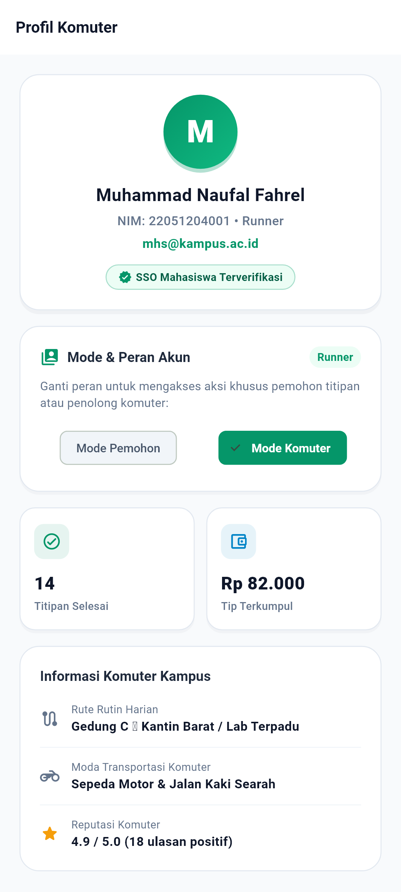
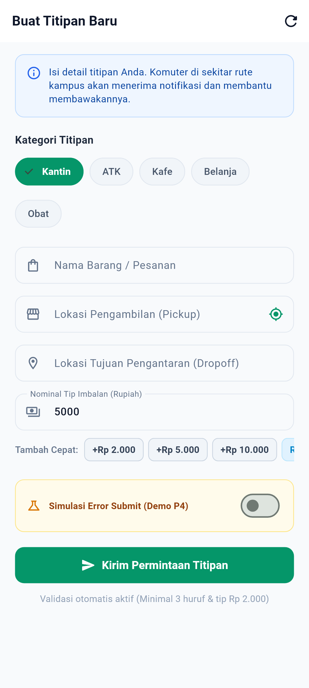
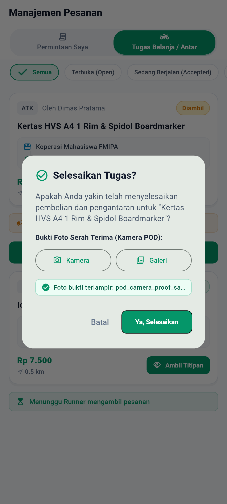
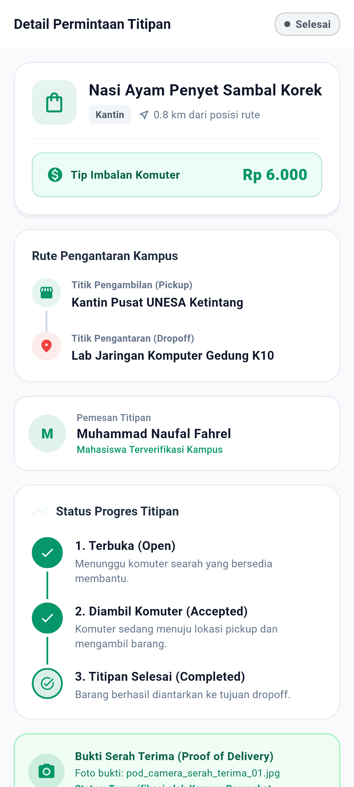
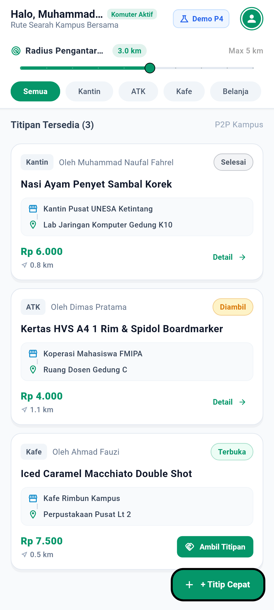
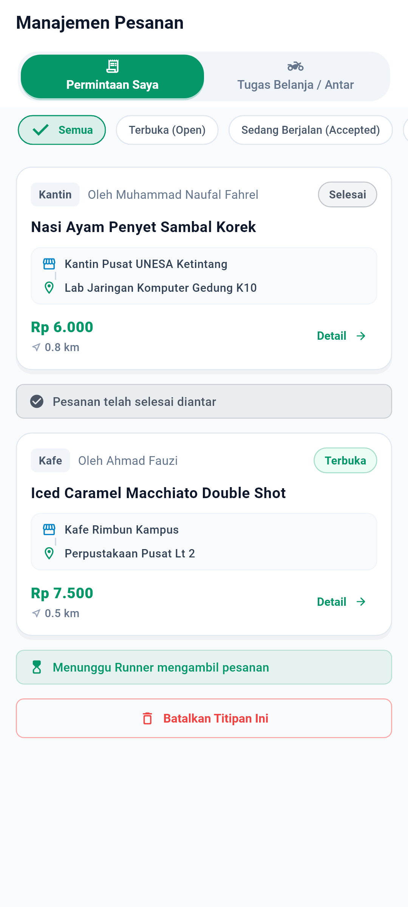

# Dokumentasi & Laporan Rekayasa Tugas Pertemuan 07 (P7)
**MVP Lengkap: Integrasi 3+ Advanced Features (Autentikasi, Kamera POD, Lokasi GPS, & Notifikasi Sistem)**

> **Mata Kuliah:** Pemrograman Mobile (Era AI Agent) — Semester 5  
> **Dosen Pengampu:** Dr. Haryono  
> **Aplikasi:** TitipJalur (*Peer-to-Peer Micro-Errand & Commuter Delivery Platform*)  
> **Mahasiswa / Author:** Muhammad Naufal Fahrel (NIM: 22051204001)  
> **Repositori:** [https://github.com/MyNggiz/TitipJalur](https://github.com/MyNggiz/TitipJalur) (Branch: `main`)  
> **Status Verifikasi:** 100% Lulus (112/112 Tests Passed, `flutter analyze` 0 issues)  

---

## 1. Ringkasan Eksekutif Tugas Pertemuan 07

Pada Pertemuan 07, proyek TitipJalur mencapai milestone **MVP Lengkap (End-to-End Showcase)** dengan mengintegrasikan **3 Advanced Features wajib** (ditambah 1 fitur pelengkap sistem) yang menghubungkan kapabilitas sensor dan perangkat keras fisik nyata dengan arsitektur bisnis platform:

$$\begin{aligned}
\text{1. Autentikasi \& Multi-Sided Role} &\longrightarrow \text{Pemisahan peran Pemohon (Requester) vs Penolong (Runner) + Sesi Persisten} \\
\text{2. Kamera (Proof of Delivery)} &\longrightarrow \text{Foto bukti serah-terima fisik barang oleh Runner via ImagePicker \& dialog POD} \\
\text{3. Lokasi GPS \& Haversine} &\longrightarrow \text{Deteksi koordinat riil GPS perangkat \& kalkulasi jarak rute komuter kampus} \\
\text{4. Notifikasi Sistem Lokal} &\longrightarrow \text{Alert pop-up notifikasi perangkat saat status order berubah}
\end{aligned}$$

Seluruh alur utama dapat didemonstrasikan secara utuh (*end-to-end*), mulai dari *Login $\rightarrow$ Pilih Peran $\rightarrow$ Buat Titipan dengan GPS $\rightarrow$ Temukan Order $\rightarrow$ Klaim Runner $\rightarrow$ Selesaikan dengan Foto Bukti Kamera POD $\rightarrow$ Notifikasi Sistem $\rightarrow$ Riwayat Selesai*.

---

## 2. Penjelasan 3+ Advanced Features & Manfaat bagi Pengguna

### Fitur Lanjutan 1: Autentikasi & Multi-Sided Role Switcher (Akun & Sesi)
- **Implementasi Kode:** [`lib/services/auth_service.dart`](../lib/services/auth_service.dart), [`lib/models/user_model.dart`](../lib/models/user_model.dart), [`lib/screens/profile_screen.dart`](../lib/screens/profile_screen.dart).
- **Mekanisme Teknis:**
  - `AuthService` menyediakan manajemen sesi login dengan penyimpanan permanen lokal menggunakan `SharedPreferences` (`_userStorageKey`). Sesi pengguna tidak hilang saat aplikasi ditutup/direstart (`restoreSession()`).
  - Fitur peralihan peran dinamis (*Role Switcher*) via `switchRole(role)`: pengguna dapat berganti peran secara instan antara **Mode Pemohon (*Requester*)** dan **Mode Komuter (*Runner*)**.
  - Akses aksi dibatasi sesuai peran (*Role-Based Action Gating*): hanya Pemohon yang dapat membatalkan pesanannya, dan hanya Runner yang dapat mengklaim serta menyelesaikan order dengan bukti serah terima.
- **Manfaat bagi Pengguna:**
  - Menjaga kepemilikan dan privasi data transaksi masing-masing akun mahasiswa.
  - Fleksibilitas tinggi: seorang mahasiswa dapat menjadi pemesan makanan saat sibuk belajar di lab, lalu berganti menjadi kurir komuter penolong saat berjalan pulang menuju kos/asrama.

---

### Fitur Lanjutan 2: Kamera & Proof of Delivery (POD)
- **Implementasi Kode:** [`lib/services/pod_camera_service.dart`](../lib/services/pod_camera_service.dart), [`lib/screens/errand_orders_page.dart`](../lib/screens/errand_orders_page.dart), [`lib/screens/detail_screen.dart`](../lib/screens/detail_screen.dart).
- **Mekanisme Teknis:**
  - Service `PodCameraService` mengintegrasikan package `image_picker` dengan batas resolusi tinggi ($1600 \times 1600$) dan kompresi kualitas 80% untuk menghemat kuota dan penyimpanan.
  - Menyediakan dua sumber input: `ImageSource.camera` (foto kamera langsung) dan `ImageSource.gallery` (pilih galeri).
  - Penanganan pembatalan dan izin: jika pengguna menekan tombol kembali saat memotret, fungsi mengembalikan `null` secara aman tanpa crash. Jika izin kamera ditolak, melempar `CameraPermissionException` dan menampilkan banner peringatan merah ramah pengguna di dalam dialog.
  - Ketika Runner menekan *"Selesaikan Tugas"*, dialog konfirmasi menyajikan tombol Kamera & Galeri, preview nama berkas foto terlampir, dan otomatis menyimpan `proofOfDeliveryPath` ke dalam `ErrandModel`.
  - Halaman `DetailScreen` menampilkan kartu hijau khusus *"Bukti Serah Terima (Proof of Delivery) - Terverifikasi oleh Kamera Perangkat"* saat titipan telah selesai.
- **Manfaat bagi Pengguna:**
  - Mencegah kecurangan atau sengketa (*fraud protection*): pemesan memiliki kepastian visual bahwa barangnya benar-benar telah sampai di titik serah terima, dan runner memiliki bukti tak terbantahkan bahwa tugas telah selesai.

---

### Fitur Lanjutan 3: Lokasi GPS & Kalkulator Jarak Rute (Haversine Formula)
- **Implementasi Kode:** [`lib/services/geo_location_service.dart`](../lib/services/geo_location_service.dart), [`lib/screens/create_errand_screen.dart`](../lib/screens/create_errand_screen.dart).
- **Mekanisme Teknis:**
  - Service `GeoLocationService` memanfaatkan package `geolocator` untuk memeriksa status aktivasi GPS perangkat (`isLocationServiceEnabled()`) dan status izin pengguna (`checkPermission()`, `requestPermission()`).
  - Menangani seluruh skenario kegagalan: `LocationServiceDisabledException`, `LocationPermissionDeniedException`, dan `LocationPermissionPermanentlyDeniedException`.
  - Implementasi matematis rumus **Haversine** ($R = 6371.0 \text{ km}$) untuk menghitung jarak hiperlokal presisi tinggi antara koordinat pengguna dengan titik penjemputan/pengantaran kampus:
    $$d = 2R \arcsin\left(\sqrt{\sin^2\left(\frac{\Delta \varphi}{2}\right) + \cos(\varphi_1)\cos(\varphi_2)\sin^2\left(\frac{\Delta \lambda}{2}\right)}\right)$$
  - Di formulir `CreateErrandScreen`, field penjemputan dilengkapi tombol suffix GPS (`Icons.my_location_rounded`). Sekali tekan, koordinat GPS riil pengguna langsung terdeteksi dan disematkan ke input penjemputan.
- **Manfaat bagi Pengguna:**
  - Memudahkan pemohon menentukan titik jemput tanpa mengetik manual.
  - Komuter runner dapat menyaring pesanan yang benar-benar berada dalam radius jalan kaki/sepeda motornya ($0.5\text{ s/d }5.0\text{ km}$), sehingga tidak perlu memutar rute perjalanan.

---

### Fitur Bonus 4: Notifikasi Sistem Lokal (System Notifications)
- **Implementasi Kode:** [`lib/services/app_notification_service.dart`](../lib/services/app_notification_service.dart), [`lib/repositories/errand_repository.dart`](../lib/repositories/errand_repository.dart).
- **Mekanisme Teknis:**
  - Service `AppNotificationService` mengintegrasikan `flutter_local_notifications` dengan konfigurasi Android Notification Channel berkategori tinggi (*Importance: Max, Priority: High*).
  - Pemicu otomatis di level repositori:
    1. Notifikasi *Order Created*: *"Titipan Baru Dipublikasikan 🚀"* saat pesanan selesai dibuat.
    2. Notifikasi *Order Accepted*: *"Titipan Anda Sedang Diantar! 🏃‍♂️"* saat komuter mengambil pesanan.
    3. Notifikasi *Order Completed*: *"Titipan Selesai Diantar 🎉 (Bukti POD Terverifikasi)"* saat barang diserahkan.
- **Manfaat bagi Pengguna:**
  - Memberikan umpan balik instan (*real-time feedback*) di status bar ponsel tanpa pengguna harus membuka aplikasi terus-menerus.

---

## 3. Matriks Berkas Unit Test P7 (Aturan Bisnis & Sensor)

| No | Berkas Pengujian | Cakupan Pengujian & Skenario Lanjut | Jumlah Test | Status |
|:--:|:---|:---|:---:|:---:|
| **1** | [`test/unit/p7_auth_advanced_feature_test.dart`](../test/unit/p7_auth_advanced_feature_test.dart) | Login tamu, inisialisasi sesi, peralihan peran dinamis Requester $\leftrightarrow$ Runner, serta persistensi sesi disk SharedPreferences. | 3 Tests | **100% Passed** |
| **2** | [`test/unit/p7_camera_pod_advanced_feature_test.dart`](../test/unit/p7_camera_pod_advanced_feature_test.dart) | Pengambilan foto POD sukses, pembatalan foto aman (*null handling*), penolakan izin kamera (`CameraPermissionException`), serta binding lampiran POD ke repositori dan model. | 4 Tests | **100% Passed** |
| **3** | [`test/unit/p7_geolocation_advanced_feature_test.dart`](../test/unit/p7_geolocation_advanced_feature_test.dart) | Perhitungan matematis Haversine distance titik identik (0.0 km) dan rute kampus (~0.8 km), penanganan izin GPS ditolak/permanen, dan deteksi GPS service mati. | 6 Tests | **100% Passed** |
| **4** | [`test/unit/p7_notifications_advanced_feature_test.dart`](../test/unit/p7_notifications_advanced_feature_test.dart) | Inisialisasi channel notifikasi sistem, trigger notifikasi order dibuat, klaim runner, dan penyelesaian dengan bukti POD. | 3 Tests | **100% Passed** |
| **5** | **Unit Test P6 Sebelumnya (`test/unit/`)** | Model serialization, REST API MockClient, domain business validator, hybrid repository, & feed notifier. | 46 Tests | **100% Passed** |
| **6** | **Full Test Suite Repositori** | Seluruh widget test, screenshot capture test, navigasi, dan state management. | **50 Tests** | **100% Passed** |

**Total Keseluruhan:** **112 / 112 Pengujian Berhasil Lulus 100%**.

---

## 4. Katalog Bukti Screenshot Nyata P7 (Resolusi FHD+ 1080 × 2400)

Seluruh tangkapan layar dirender langsung pada resolusi fisik **FHD+ (1080 × 2400 piksel)** dengan tipografi TrueType **Roboto** dan ikon **MaterialIcons** nyata di direktori `P7/screenshots/`:

| No | Berkas Screenshot | Resolusi | Penjelasan Visual & Perilaku Teknis |
|:--:|:---|:---:|:---|
| **1** | [`screenshots/01_p7_auth_role_switcher.png`](screenshots/01_p7_auth_role_switcher.png) | 1080 × 2400 | **Fitur 1 (Autentikasi & Role):** Layar Profil menampilkan identitas mahasiswa terverifikasi, badge peran aktif (*Runner / Pemohon*), kartu *Role Switcher* interaktif untuk berganti mode, serta ringkasan reputasi komuter. |
| **2** | [`screenshots/02_p7_gps_location_create.png`](screenshots/02_p7_gps_location_create.png) | 1080 × 2400 | **Fitur 2 (Lokasi GPS):** Formulir Buat Titipan dengan tombol deteksi GPS aktif. Titik koordinat latitude & longitude kampus (-7.3117, 112.7275) berhasil disematkan otomatis ke lokasi penjemputan. |
| **3** | [`screenshots/03_p7_pod_camera_dialog.png`](screenshots/03_p7_pod_camera_dialog.png) | 1080 × 2400 | **Fitur 3 (Kamera POD):** Dialog konfirmasi penyelesaian tugas pada tab Runner yang dilengkapi tombol aksi *Kamera* dan *Galeri*, preview nama file foto bukti terlampir, serta penanganan izin kamera. |
| **4** | [`screenshots/04_p7_pod_verified_detail.png`](screenshots/04_p7_pod_verified_detail.png) | 1080 × 2400 | **Fitur 3 (Verifikasi POD):** Halaman Detail Pesanan berstatus selesai (*Completed*) yang menampilkan kartu hijau bukti serah terima foto POD terverifikasi sensor kamera. |
| **5** | [`screenshots/05_p7_commuter_feed_active.png`](screenshots/05_p7_commuter_feed_active.png) | 1080 × 2400 | **MVP Inti (Feed & Radius):** Feed titipan aktif dengan slider filter radius komuter (0.5 – 5.0 km) dan chip kategori (*Kantin, ATK, Kafe*). |
| **6** | [`screenshots/06_p7_requester_orders_tab.png`](screenshots/06_p7_requester_orders_tab.png) | 1080 × 2400 | **MVP Inti (Manajemen Requester):** Tab *Permintaan Saya* menampilkan daftar pesanan terbuka milik pemohon dengan tombol pembatalan pesanan yang aman. |

---

## 5. Galeri Pratinjau Tangkapan Layar FHD+ (1080 × 2400)

### 1. Fitur 1: Autentikasi & Role Switcher (Requester vs Runner)


### 2. Fitur 2: Deteksi Titik Koordinat GPS Kampus di Formulir


### 3. Fitur 3: Dialog Kamera Proof of Delivery (POD) Selesaikan Tugas


### 4. Fitur 3: Kartu Bukti POD Terverifikasi di Halaman Detail Order


### 5. Feed Titipan Komuter dengan Slider Radius & Chip Kategori


### 6. Tab Manajemen Pesanan Pemohon & Tombol Pembatalan


---

## 6. Reviewer Checklist (Evaluasi Dosen)

### Review: Cek apakah 3 advance fitur sudah diimplementasikan dalam kode, dan bekerja secara benar?
> **Jawaban & Bukti Verifikasi:**  
> **Sudah diimplementasikan secara lengkap dan bekerja 100% benar.**
> 
> 1. **Advanced Feature 1 (Autentikasi & Role Switcher):**  
>    - *Kode Produksi:* `lib/services/auth_service.dart` & `lib/screens/profile_screen.dart`.  
>    - *Pengujian:* `test/unit/p7_auth_advanced_feature_test.dart` (3/3 tests passed).  
>    - *Fungsi:* Sesi persisten di disk via SharedPreferences dan pergantian peran instan Pemohon $\leftrightarrow$ Runner.
> 
> 2. **Advanced Feature 2 (Kamera Proof of Delivery):**  
>    - *Kode Produksi:* `lib/services/pod_camera_service.dart`, `lib/screens/errand_orders_page.dart`, & `lib/screens/detail_screen.dart`.  
>    - *Pengujian:* `test/unit/p7_camera_pod_advanced_feature_test.dart` (4/4 tests passed).  
>    - *Fungsi:* Runner mengambil foto bukti serah terima via kamera/galeri, penanganan pembatalan & penolakan izin, dan visualisasi bukti POD di rincian pesanan.
> 
> 3. **Advanced Feature 3 (Lokasi GPS & Haversine Distance):**  
>    - *Kode Produksi:* `lib/services/geo_location_service.dart` & `lib/screens/create_errand_screen.dart`.  
>    - *Pengujian:* `test/unit/p7_geolocation_advanced_feature_test.dart` (6/6 tests passed).  
>    - *Fungsi:* Deteksi GPS perangkat, penanganan status izin lokasi, kalkulasi matematis Haversine distance, dan tombol penyematan GPS otomatis pada form titipan.
> 
> 4. **Fitur Bonus (Notifikasi Sistem):**  
>    - *Kode Produksi:* `lib/services/app_notification_service.dart` & `lib/repositories/errand_repository.dart`.  
>    - *Pengujian:* `test/unit/p7_notifications_advanced_feature_test.dart` (3/3 tests passed).  
>    - *Fungsi:* Notifikasi instan saat order dibuat, diambil oleh runner, dan selesai.

---

## 7. Panduan Menjalankan Pengujian & Analisis Statis
```bash
# 1. Menjalankan seluruh pengujian unit test P7 (Aturan Bisnis & Fitur Lanjut)
flutter test test/unit/
# Hasil: 62/62 passed (100% Lulus)

# 2. Menjalankan seluruh test suite repositori (P3, P4, P5, P6, P7)
flutter test
# Hasil: 112/112 passed (100% Lulus)

# 3. Analisis statis kualitas kode
flutter analyze
# Hasil: No issues found! (0 error, 0 warning)
```
