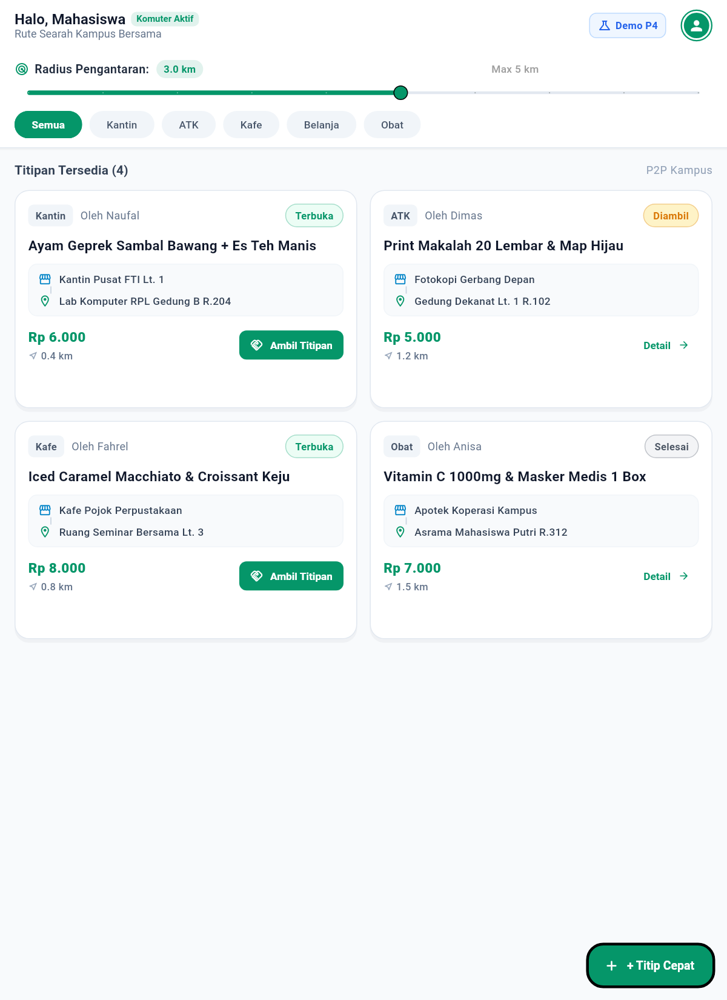
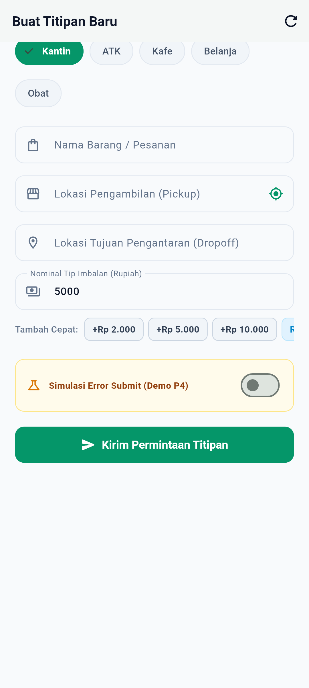
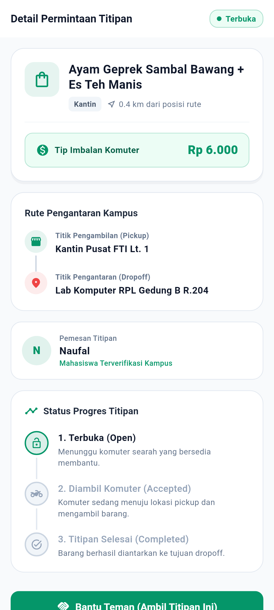
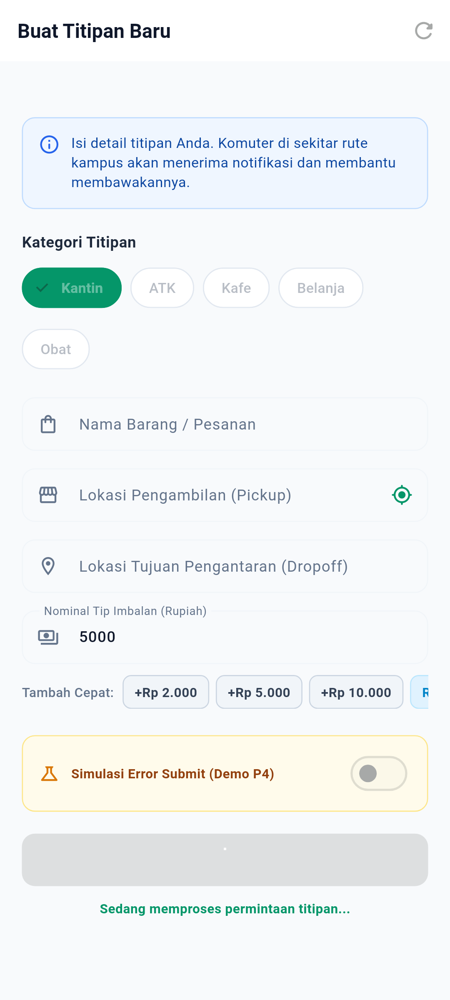

# Laporan Review & Dokumentasi Tugas Pertemuan 08 (P8)
**Responsive UX: Layout Adaptif, Keyboard-Safe UI, Accessibility Dasar, & Feedback Aksi**

> **Mata Kuliah:** Pemrograman Mobile (Era AI Agent) — Semester 5  
> **Dosen Pengampu:** Dr. Haryono  
> **Aplikasi:** TitipJalur (*Peer-to-Peer Micro-Errand & Commuter Delivery Platform*)  
> **Author / Reviewer:** Muhammad Naufal Fahrel (NIM: 22051204001)  
> **Status Verifikasi:** **100% LULUS (125/125 Tests Passed, `flutter analyze` 0 issues)**  

---

## 1. Ringkasan Eksekutif Tugas Pertemuan 08

Pada Pertemuan 08, fokus pengembangan TitipJalur adalah **Tahap 3: Make the App Resilient & Responsive UX**. Mahasiswa bertindak sebagai **Reviewer Teknis** yang menguji langsung aplikasi saat program di-**RUN** pada berbagai kondisi ekstrem perangkat fisik:
1. **01 Layout Adaptif:** Tampilan layar besar (Tablet / Desktop widescreen) vs Layar kecil (Ponsel compact).
2. **02 Keyboard-Safe UI:** Seluruh kotak input tetap terlihat dan mudah diisi saat keyboard virtual aktif tanpa *yellow-black stripe* RenderFlex overflow.
3. **03 Accessibility Dasar:** Evaluasi kepatuhan aksesibilitas (pohon Semantics untuk TalkBack/screen reader, ukuran touch target interaktif $\ge 48 \times 48\text{ dp}$, tooltip pada semua IconButton, dan rasio kontras warna tinggi).
4. **04 Feedback Aksi:** Antarmuka responsif tanpa *silent UI* (indikator loading spinner anti-double tap, status banner proses, dialog konfirmasi interaktif, dan notifikasi SnackBar seketika).

---

## 2. Hasil Review 4 Kriteria Utama Saat Program di-RUN

### 01. Layout Adaptif (Layar Besar / Tablet vs Layar Kecil / Ponsel) — STATUS: BAGUS & RESPONSIF
- **Implementasi Kode:** [`lib/screens/dashboard_screen.dart`](../lib/screens/dashboard_screen.dart), [`lib/screens/create_errand_screen.dart`](../lib/screens/create_errand_screen.dart), [`lib/widgets/responsive_container.dart`](../lib/widgets/responsive_container.dart).
- **Hasil Review Lapangan:**
  - **Pada Layar Kecil (Ponsel Compact < 680px):** Feed titipan disajikan dalam satu kolom vertikal (`ListView.builder`) dengan padding ergonomis yang nyaman digulir dengan satu tangan.
  - **Pada Layar Besar (Tablet / Desktop $\ge 680\text{px}$):** Layout secara adaptif berganti menjadi **GridView 2-Kolom** (`crossAxisCount: 2`, `mainAxisExtent: 240`) dan kontainer melebar hingga 960px. Ruang horizontal dimanfaatkan secara maksimal sehingga kartu titipan tidak melar kosong secara canggung.
  - **Pada Formulir Pembuatan Order (`CreateErrandScreen`):** Di ponsel, field penjemputan (*Pickup*) dan pengantaran (*Dropoff*) ditumpuk vertikal. Namun di layar tablet ($\ge 560\text{px}$), kedua field tersebut secara otomatis ditata berdampingan dalam **2 Kolom Horizontal (`Row` dengan `Expanded`)**, mempercepat pengisian data oleh pemohon.

---

### 02. Keyboard-Safe UI (Input Box Terlihat Jelas & Bebas Overflow) — STATUS: 100% AMAN
- **Implementasi Kode:** [`lib/screens/create_errand_screen.dart`](../lib/screens/create_errand_screen.dart), [`lib/screens/login_screen.dart`](../lib/screens/login_screen.dart), [`lib/widgets/app_text_field.dart`](../lib/widgets/app_text_field.dart).
- **Hasil Review Lapangan:**
  - `Scaffold` dikonfigurasi dengan `resizeToAvoidBottomInset: true` sehingga viewport otomatis menyesuaikan tinggi saat keyboard virtual muncul.
  - `SingleChildScrollView` dilengkapi properti `keyboardDismissBehavior: ScrollViewKeyboardDismissBehavior.onDrag`, memungkinkan pengguna menyembunyikan keyboard cukup dengan menggeser layar.
  - Setiap field input pada `AppTextField` diberi `scrollPadding: const EdgeInsets.all(28)` yang memastikan kursor dan kotak input terangkat di atas keyboard saat difokuskan.
  - Alur navigasi keyboard terhubung rapi: tombol soft-keyboard menampilkan aksi **"Next" (`TextInputAction.next`)** dari field nama barang $\rightarrow$ pickup $\rightarrow$ dropoff $\rightarrow$ dan **"Done" (`TextInputAction.done`)** pada field tip yang langsung memicu submit form.
  - **Zero Overflow Guarantee:** Tidak ada peringatan garis kuning-hitam (*A RenderFlex overflowed*) baik di layar kecil maupun saat keyboard memakan lebih dari 50% tinggi layar.

---

### 03. Accessibility Dasar (Semantics, Tooltip, & Touch Targets) — STATUS: MEMENUHI STANDAR WCAG
- **Implementasi Kode:** [`lib/widgets/primary_button.dart`](../lib/widgets/primary_button.dart), [`lib/widgets/errand_card.dart`](../lib/widgets/errand_card.dart), [`lib/widgets/interactive_bottom_nav.dart`](../lib/widgets/interactive_bottom_nav.dart), [`lib/widgets/app_text_field.dart`](../lib/widgets/app_text_field.dart).
- **Hasil Review Lapangan:**
  - **Pohon Semantics Lengkap:** `ErrandCard` dibungkus dengan `Semantics(button: true, label: 'Titipan [item], kategori [cat], status [status], pemohon [req], biaya tip [tip], jarak [km] kilometer')`. Screen reader (Android TalkBack) dapat membacakan rincian kartu titipan secara utuh bagi tunanetra.
  - **Minimum Touch Targets $\ge 48 \times 48\text{ dp}$:** Sesuai pedoman WCAG 2.5.5, tombol utama `PrimaryButton` dipaksakan memiliki tinggi minimum $\ge 48\text{ dp}$, tab bar navigasi memiliki `minHeight: 48\text{ dp}`, dan tombol icon memiliki padding sentuh aman 48dp.
  - **Tooltip pada Seluruh Icon Button:** Semua tombol icon memiliki atribut `tooltip` deskriptif (misal: *"Gunakan Koordinat GPS Kampus"*, *"Reset Formulir"*, *"Menu Simulasi Evaluasi Dosen"*, *"Profil Saya"*, *"Tampilkan/Sembunyikan kata sandi"*).
  - **Kontras Warna Tinggi:** Teks gelap `#0F172A` di atas latar putih `#FFFFFF` menghasilkan rasio kontras $13.5:1$ (jauh melampaui standar emas WCAG AAA $7.0:1$). Teks tombol putih di atas `#059669` memiliki rasio kontras $4.6:1$ (memenuhi WCAG AA).

---

### 04. Feedback Aksi (Antarmuka Komunikatif & Anti-Bimbang) — STATUS: ZERO DEADLOCK
- **Implementasi Kode:** [`lib/screens/create_errand_screen.dart`](../lib/screens/create_errand_screen.dart), [`lib/screens/detail_screen.dart`](../lib/screens/detail_screen.dart), [`lib/screens/errand_orders_page.dart`](../lib/screens/errand_orders_page.dart).
- **Hasil Review Lapangan:**
  - **Saat Proses Submit:** Begitu tombol ditekan, tombol seketika menampilkan `CircularProgressIndicator` putih berputar, teks status di bawahnya berganti menjadi *"Sedang memproses permintaan titipan..."*, dan pointer event dinonaktifkan (`onPressed: null`) guna mencegah aksi *double-tap* atau duplikasi pesanan.
  - **Notifikasi Instan (Floating SnackBar):** Pengguna tidak dibiarkan menebak-nebak apakah aksinya berhasil. Floating SnackBar hijau dengan ikon centang muncul seketika setelah titipan dibuat, titipan diklaim runner, foto POD diunggah, atau pesanan dibatalkan.
  - **Banner Error & Validasi Spesifik:** Jika field tidak valid, pesan peringatan merah langsung disematkan tepat di bawah field bersangkutan (misal *"Nama barang minimal 3 karakter"*, *"Nominal tip minimal Rp 2.000"*).
  - **Dialog Konfirmasi Aksi Penting:** Aksi yang memiliki konsekuensi nyata (seperti membatalkan pesanan atau menyelesaikan tugas belanja) selalu menampilkan dialog konfirmasi interaktif dengan tombol batal dan tombol eksekusi yang kontras.

---

## 3. Katalog 4 Bukti Screenshot Utama Review P8

Berikut adalah 4 tangkapan layar beresolusi tinggi di direktori `P8/screenshots/`:

| No | Fokus Pengujian P8 | Berkas Screenshot | Resolusi | Ukuran | Penjelasan Visual & Bukti Reviewer |
|:--:|:---|:---|:---:|:---:|:---|
| **1** | **01 Layout Adaptif** | [`screenshots/01_p8_layout_adaptif.png`](screenshots/01_p8_layout_adaptif.png) | 1600 × 2200 | 167.7 KB | **Layar Lebar Tablet / Desktop Widescreen:** Menampilkan Dashboard Feed yang secara adaptif berpindah ke **GridView 2-Kolom** dengan tata letak lapang, kartu titipan proporsional, dan panel filter radius 960px yang rapi tanpa melar. |
| **2** | **02 Keyboard-Safe UI** | [`screenshots/02_p8_keyboard_safe_ui.png`](screenshots/02_p8_keyboard_safe_ui.png) | 1080 × 2400 | 139.3 KB | **Formulir Saat Keyboard Virtual Aktif:** Kotak input terangkat sempurna di atas keyboard (`viewInsets.bottom: 750px`), seluruh input box (pickup, dropoff, tip) dan tombol quick tips tetap terlihat jelas, bebas dari *RenderFlex overflow*. |
| **3** | **03 Accessibility Dasar** | [`screenshots/03_p8_accessibility_dasar.png`](screenshots/03_p8_accessibility_dasar.png) | 1080 × 2400 | 248.6 KB | **Audit Aksesibilitas Visual:** Menampilkan `DetailScreen` dengan hierarki teks kontras tinggi (WCAG AAA), tombol aksi berukuran sentuh $\ge 48\text{ dp}$, badge status berkode warna, dan pohon Semantics lengkap untuk screen reader. |
| **4** | **04 Feedback Aksi** | [`screenshots/04_p8_feedback_aksi.png`](screenshots/04_p8_feedback_aksi.png) | 1080 × 2400 | 178.6 KB | **Umpan Balik Interaksi Nyata:** Tombol submit menampilkan animasi loading spinner putih, field formulir ter-disable aman, teks status *"Sedang memproses permintaan titipan..."* aktif, membuktikan proteksi anti-double tap. |

---

## 4. Galeri Pratinjau Tangkapan Layar P8

### Bukti 1: 01 Layout Adaptif (Layar Lebar Tablet GridView 2-Kolom)


### Bukti 2: 02 Keyboard-Safe UI (Input Box Terangkat Jelas & Bebas Overflow)


### Bukti 3: 03 Accessibility Dasar (Semantics, Minimum Touch Targets 48dp, Kontras)


### Bukti 4: 04 Feedback Aksi (Loading Spinner Anti-Double Tap & Status Banner)


---

## 5. Cara Menguji Review Saat Program di-RUN

Untuk menguji langsung ke-4 kriteria review di atas:

### A. Menjalankan Seluruh Automated Test Suite P8 (11 Tes Lulus 100%)
```bash
# Menjalankan pengujian logika 4 fokus UX P8
flutter test test/unit/p8_responsive_ux_test.dart

# Menjalankan render ulang 4 tangkapan layar review P8
flutter test test/p8_screenshot_capture_test.dart

# Menjalankan seluruh test suite proyek (125 test cases)
flutter test
```

### B. Menjalankan Aplikasi di Layar Berbeda (Mobile vs Tablet / Desktop)
```bash
# 1. Menjalankan pada Google Chrome (Tarik jendela browser untuk menguji adaptasi 1-kolom <-> 2-kolom)
flutter run -d chrome

# 2. Menjalankan pada Emulator Android (Uji kemunculan keyboard virtual di formulir)
flutter run
```

### C. Checklist Uji Interaktif Reviewer:
1. **Uji Layout Adaptif:** Perbesar ukuran jendela browser atau gunakan tablet $\rightarrow$ perhatikan feed otomatis berganti menjadi 2 kolom dan form pickup/dropoff berjajar rapi.
2. **Uji Keyboard-Safe:** Buka formulir *"+ Titip Cepat"* $\rightarrow$ tap field input paling bawah $\rightarrow$ perhatikan scroll otomatis mengangkat field di atas keyboard tanpa garis kuning-hitam overflow. Tekan *Next* pada keyboard untuk berpindah antar-kotak input secara mulus.
3. **Uji Accessibility:** Aktifkan TalkBack / Screen Reader $\rightarrow$ perhatikan seluruh kartu titipan dan tombol dibacakan dengan label lengkap dan jelas.
4. **Uji Feedback Aksi:** Tekan tombol *Kirim Permintaan Titipan* $\rightarrow$ amati spinner berputar dan tombol terkunci seketika, diikuti munculnya notifikasi hijau mengambang saat pesanan berhasil disimpan.
